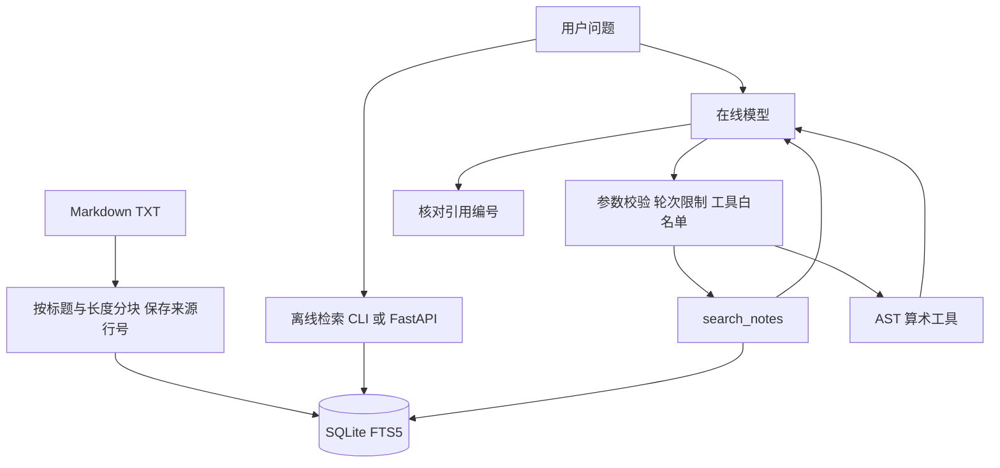

# ArchiEvidence

带来源引用的学习笔记检索与工具调用 Agent。项目以建筑学习笔记和 AI 工程笔记为样例，展示文档分块、BM25 检索、来源追踪、工具白名单与可复现评测。

**离线版可直接运行，无 API 密钥、无第三方依赖。** 网页使用可选 FastAPI 服务。在线 Agent 使用 Chat Completions 兼容接口，需要自己的 API 密钥。

## 三分钟开始

需要 Python 3.10+，SQLite 必须支持 FTS5。

```bash
python -m archi_agent index
python -m archi_agent ask "RAG 的流程是什么？"
python -m unittest discover -s tests -v
python evaluate.py
```

离线输出包含 `mode: offline-extractive`、原文片段、文件名、行号、片段编号与单次检索耗时。它只展示检索摘录，没有生成式推理。不要把离线演示称为实测大模型表现。

## 启动网页

```bash
python -m pip install -r requirements.txt
python -m archi_agent index
python -m uvicorn archi_agent.api:create_app --factory --host 127.0.0.1 --port 8000
```

打开 `http://127.0.0.1:8000`，接口文档在 `/docs`。示例请求：

```bash
curl -X POST http://127.0.0.1:8000/api/ask -H "Content-Type: application/json" -d '{"question":"RAG 是什么？","top_k":3}'
```

网页只提供离线检索，不会意外产生模型费用。该演示没有登录鉴权，默认仅在本机使用。

## 在线工具调用 Agent

PowerShell 配置示例，不要把真实密钥写进文件或提交到 Git：

```powershell
$env:LLM_API_KEY="你的密钥"
$env:LLM_BASE_URL="https://api.deepseek.com"
$env:LLM_MODEL="服务商当前可用且支持工具调用的模型名"
python -m archi_agent ask "检索自然通风的注意点，再计算 (12*8)/3" --online
```

配置也适用于接受相同协议的其他 HTTPS 接口，兼容性需逐个供应商验证。系统自动给 DeepSeek 接口设置非思考模式。当前没有真实在线模型的调用记录与质量结果；工具循环通过脚本化模拟客户端验证。

Agent 可以调用 `search_notes(query)` 和 `calculate(expression)`，每轮最多四个工具调用、最多五轮。模型返回的参数必须经过本地校验。工具错误会回传给模型，超出轮次后终止。引用编号必须来自已检索结果，否则停止输出结论。

**引用存在不等于语义正确**；提示词也不能保证免疫提示注入。程序层面没有 Shell、任意代码执行或文件写入工具。

## 架构



中文采用字符二元组、英文采用词项，再由 SQLite FTS5 BM25 排序。**当前未实现 embedding、向量数据库、重排、LangChain、LangGraph、多 Agent 或模型微调。** 这些属于后续扩展，不能作为已经掌握的项目技术栈。

## MCP 工具接口

可选 MCP 接口使用官方 Python SDK v2，**此部分需要 Python 3.11+**。

```bash
python -m pip install -r requirements-mcp.txt
python -m archi_agent index
python mcp_launcher.py
```

启动后等待客户端通过 stdio 发送协议消息，不会显示网页。MCP Host 的启动配置示例：

```json
{
  "mcpServers": {
    "archi-evidence": {
      "command": "你的虚拟环境中python的绝对路径",
      "args": ["项目绝对路径/mcp_launcher.py"]
    }
  }
}
```

按具体客户端的配置格式填入真实路径。接口仅暴露 `search_notes` 和 `calculate`，已通过官方 SDK 内存客户端测试；没有修改本机 Codex 或 Claude Code 的配置，也没有声称已在这些客户端完成联调。详见 [MCP SDK 运行说明](https://py.sdk.modelcontextprotocol.io/run/)。

## 自己的知识库

```bash
python -m archi_agent index path/to/notes
```

支持 UTF-8 `.md` / `.txt`，单文件最多 1 MB。一次索引将原子替换当前知识库，删除旧片段。路径、行号与内容保留在 `data/knowledge.sqlite3`，不会提交到 Git。

## 测试与评测

```bash
python -m pip install -r requirements-dev.txt
python -m pip install -r requirements-mcp.txt
python -m unittest discover -s tests -v
python evaluate.py --output reports/evaluation.json
```

测试涵盖检索来源、重复索引、删除文档、查询边界、算式限制、伪造引用、非法参数、未知工具和最大轮次。API 测试需要可选依赖，未安装时会显式跳过。模拟客户端测试不能替代真实服务商端到端验证。

评测集为 **15 道自建演示题：12 道有答案、3 道无答案**。报告含 Hit@3、MRR@3、无答案空结果比例和逐题结果。题目与样例笔记由同一项目作者设计，没有严格的数据隔离，不能把结果写成“模型准确率 100%”。具体本次结果和失败案例见 `reports/evaluation.json`。

## 容器与 CI

```bash
docker build -t archi-evidence .
docker run --rm -p 127.0.0.1:8000:8000 archi-evidence
```

提供 Dockerfile 与 GitHub Actions 配置；本次是否实际验证见 `reports/validation.md`。不要把配置文件的存在写成已经上线部署。

## 开发与学习

本项目采用 AI 辅助编程完成初版，用于学习和作品展示。请亲自运行、读懂、修改，再在面试中说明自己的实现与取舍。样例笔记是原创教学材料，不是建筑设计规范。

协议格式参考 [DeepSeek Tool Calls](https://api-docs.deepseek.com/guides/tool_calls/)。许可证见 `LICENSE`。

## 产品方案

[产品需求、功能取舍与验收说明](docs/PRODUCT.md)补充了用户场景、核心流程、验收标准和待验证指标。用户访谈、试用与效果数据尚未采集。
